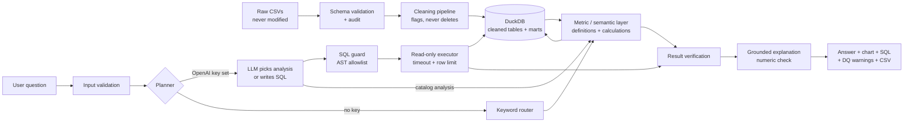

# SaaS Intelligence Copilot

Ask questions about SaaS subscription data in plain English and get answers that are **calculated, not invented**: every number comes from a documented metric function or a validated, read-only SQL query, every answer shows how it was calculated, and every result is shown next to the data-quality issues that could change it.

> **Dataset caveat.** The data is the *RavenStack SaaS Subscription & Churn Analytics* dataset, described by its public listing as **synthetic** (the ZIP supplied for this project contained only CSVs, so that is not confirmed by the files themselves). Findings illustrate the method, not a real business. All revenue figures are *recorded subscription amounts*, not cash.


## What is verified and what is not

| Item | Status |
|---|---|
| Data audit, cleaning pipeline, DuckDB build | ✅ run on the real data; tables reconcile (500 / 5,000 / 600 / 2,000 / 25,000 rows) |
| Metric layer, dashboard, offline copilot | ✅ tested; key values cross-checked against independent pandas calculations |
| SQL safety (40 attack cases), timeouts, read-only DB | ✅ tested |
| Fresh-clone install from `requirements.txt` + tests (no raw data) | ✅ run in a clean virtualenv |
| **Live OpenAI integration** | ⚠️ **not run** (no API key was available). Implemented and tested against a *scripted stub*; one credential-gated test is provided. Model output quality is unverified. |
| UI redesign: themes, layout, contrast | ✅ checked in real Chromium on Linux (all pages, 3 themes, phone and tablet widths) and by 79 automated tests. ⚠️ **Not checked:** Windows/Edge/Firefox/Safari rendering, screen readers. |
| GitHub repository / live deployment | ⚠️ **not done** (no credentials). Exact commands below. |

## Features

- **Overview dashboard**: an executive summary whose every figure is computed, five KPI tiles with sparklines, and six tabs (revenue, customers, churn & retention, segments, support & usage, insights). Filters (date, industry, country, referral source, plan) sit in a collapsible bar; insights export to Markdown.
- **Design system**: three themes (Dark, Light, Midnight) and five accents, applied consistently to every page, chart, input, dropdown and table; remembered across pages and browser refreshes. See [Design system](#design-system).
- **AI Copilot**: chat with follow-ups; picks a *trusted analysis* when one fits, otherwise writes SQL that is validated before running; shows SQL/method, caveats, CSV download, and relevant data-quality warnings.
- **Data Quality page**: source status (what the database was built from, and whether the audit describes the same files), 21 audited issues with severity, affected records, impact and handling, 16 passed checks, table profiles.
- **Methodology page**: the selected MRR definition **side by side with alternatives** (they differ ~7x), plus the full metric registry with formula, date basis, grain, assumptions and limitations.
- **Honest limits**: CLV, CAC, NRR, trial conversion and cash revenue are labelled *unavailable* and never computed.

## Design system

Three themes and five accents, chosen in the sidebar under **Appearance**:

| Theme | Character |
|---|---|
| **Dark** (default) | near-black surfaces, indigo accent |
| **Light** | white cards on a soft grey canvas, deeper accent shades for readability |
| **Midnight** | deep navy, teal accent |

Accents: Auto (each theme's signature), Indigo, Teal, Violet, Amber. The selection is kept while you navigate and mirrored in the URL (`?theme=Light&accent=Teal`), so a refresh or a shared link keeps it; a first visit to the bare URL starts in Dark.

Every text colour pair is tested against WCAG 2.1 AA for every theme and accent, including on the tinted backgrounds the colours are drawn on. A real-browser audit (`scripts/ui_audit.py`, optional, needs Playwright) found 0 text elements below AA across all pages and Overview tabs in all three themes. Details, token tables, rules for contributors and **known limitations** are in [`docs/DESIGN_SYSTEM.md`](docs/DESIGN_SYSTEM.md). No new runtime dependencies were added.

## Architecture



**Why the AI cannot make things up:** the model only *chooses* an analysis or *writes SQL*. Numbers come from the database. If an AI-written explanation contains a number that cannot be traced to the result table, it is discarded and the deterministic summary is shown instead.

## Tech stack

Python 3.12 · Pandas · DuckDB · Streamlit · Plotly · sqlglot (SQL validation) · SciPy (chi-square, Mann-Whitney) · OpenAI API · Pytest.

## Dataset source and licence

- Source: https://www.kaggle.com/datasets/rivalytics/saas-subscription-and-churn-analytics-dataset (River @ Rivalytics).
- The ZIP provided contained **no README or licence**. Secondary sources describe it as synthetic and free for educational/portfolio use with credit. **Verify the licence on the Kaggle page before redistributing**, and credit the author.
- The raw data is **not committed** (`data/raw/` is git-ignored). A 60-account **demo sample** (`data/sample/`, 260 KB) is bundled so the app runs after a fresh clone; the UI states clearly when it is showing the sample.

## Quick start

```bash
python -m venv .venv && source .venv/bin/activate      # Windows: .venv\Scripts\activate
pip install -r requirements.txt

# Full data: download the Kaggle dataset and put the five CSVs in data/raw/
#   ravenstack_accounts.csv, ravenstack_subscriptions.csv, ravenstack_churn_events.csv,
#   ravenstack_support_tickets.csv, ravenstack_feature_usage.csv
python -m src.data.pipeline          # audit -> docs/DATA_QUALITY_REPORT.md, clean, build data/processed/saas.duckdb

cp .env.example .env                 # optional: add OPENAI_API_KEY for free-form questions
python -m streamlit run app.py
```

Without `data/raw/` the app builds from the demo sample. Without an API key it runs in **offline mode**: a keyword router maps questions to the same trusted analyses (all example questions and simple follow-ups work; arbitrary questions need a key).

### Environment variables

See `.env.example`. The key is read from the environment only; the placeholder value is ignored. Logs never contain question text, SQL, results or keys.

## Testing

```bash
python -m pytest -q
```

Latest runs:

- Working copy with full data: **223 passed, 1 skipped** (the original suite of 144 + 1 is unchanged; 79 tests were added for the design system, theme persistence and page rendering in every theme).
- Fresh clone, clean virtualenv, no raw data: see `docs/TEST_RESULTS.md`.
- The skipped test (`needs_credentials`) calls the real OpenAI API and runs only when `OPENAI_API_KEY` is set. **End-to-end LLM behaviour is therefore untested here.**

Coverage: schema validation, duplicate/orphan detection, DB build and no-fan-out checks, metrics against hand-derived values, date and category filters, join double-counting, 40 unsafe/invalid SQL cases, timeouts, row limits, read-only enforcement, empty/missing-column results, API failure fallback, grounding, and app startup/interaction for every page.

## Deployment

**Streamlit Community Cloud** (needs your GitHub + Streamlit account): push the repo, create an app with entry point `app.py`, add `OPENAI_API_KEY` under *Secrets* (optional). With no raw data in the repo it will run on the demo sample.

**Docker:**
```bash
docker build -t saas-copilot .
docker run -p 8501:8501 -e OPENAI_API_KEY=... saas-copilot        # add -v $PWD/data/raw:/app/data/raw for full data
```
(The Dockerfile was written but **not built** in this environment.)

### Publish to GitHub

```bash
git remote add origin https://github.com/<you>/saas-intelligence-copilot.git
git push -u origin main
```

## Security model

Defence in depth for AI-generated SQL: (1) sqlglot AST validation - single `SELECT`, table and function allowlists, no table functions/paths, no unconstrained joins, size caps; (2) the executed SQL is *regenerated from the validated AST* with comments stripped, so no parser differential; (3) DuckDB opened `READ_ONLY` with external file access disabled and a memory limit; (4) row limit and wall-clock timeout. There is no file-upload feature (no upload attack surface) and the model has no shell or file access.

## Known data-quality limitations (summary)

Full detail in `docs/DATA_QUALITY_REPORT.md` and the Data Quality page.

- **Conflicting churn indicators**: `churn_flag` disagrees with churn events for 62% of accounts; all 110 flagged accounts still hold open paid subscriptions.
- **MRR is definition-dependent**: ~10 subscription rows per account; summing concurrent rows gives $10.16M, one-row-per-account gives $1.36M.
- **Usage is not time-aligned** (78% of rows fall outside their subscription window) so only lifetime aggregates are used.
- **No payments, spend or user-level data**: cash revenue, LTV, CAC, NRR are unavailable.
- **No segment shows a statistically reliable churn difference** (industry p = 0.066, channel p = 0.079; no multiple-comparison correction applied).
- Churn activity is concentrated in the last quarter (67% of subscription endings), which confounds cohort comparisons.

## Data dictionary and metrics

Table schemas: Methodology page (generated from `src/data/schema.py`). Every metric: `docs/METRICS.md` (generated from `src/metrics/definitions.py`). Decisions and assumptions: `docs/DECISIONS.md`.

## Project layout

```
app.py                  entry point (navigation)
views/                  overview, copilot, data_quality, methodology (presentation only)
src/data/               schema validation, loader, audit, cleaning + marts, pipeline
src/metrics/            definitions (registry), calculations, stats
src/analytics/          db (read-only exec), catalog, insights, verification, dq_warnings
src/ai/                 client, prompts, planner, router, grounding, explain, copilot
src/security/           sql_guard, input_validation, logging_utils
src/ui/                 theme (tokens, accessibility maths), kit (components), charts, shell (theme state), components, assets/app.css
tests/  scripts/  docs/  data/{raw,sample,processed}
```

## Screenshots

Real captures of the running app in **offline mode** on the full dataset, taken after rendering had finished.

| Dark (default) | Light | Midnight |
|---|---|---|
|  |  |  |

| Copilot | Data quality | Methodology | Phone width |
|---|---|---|---|
|  |  |  |  |

## Limitations and future work

- Live LLM mode needs validation with a real key (prompt tuning, model choice; `OPENAI_MODEL` defaults to `gpt-4.1-mini`, unverified).
- Offline routing covers built-in analyses only.
- No multiple-comparison correction; no predictive churn model (the audited data showed no usable signal, so none is offered).
- Future: payments/invoices schema, a dated churn-status table, semantic caching, evaluation set for the planner, authentication for multi-user deployment.
