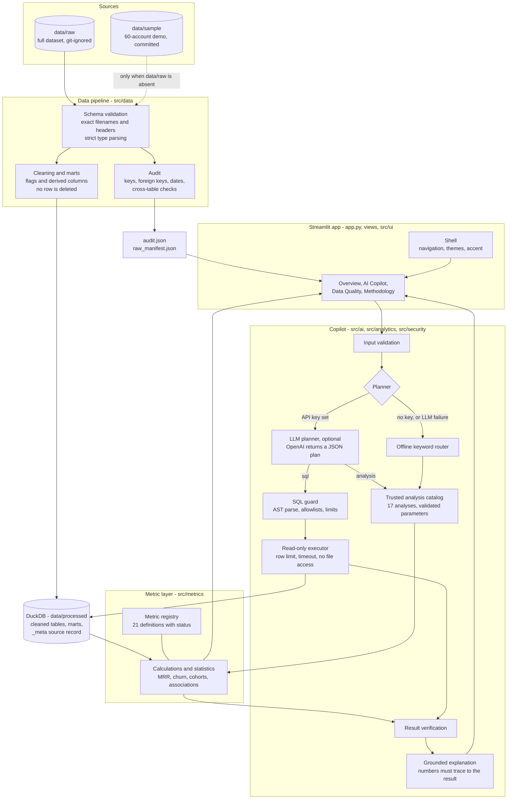
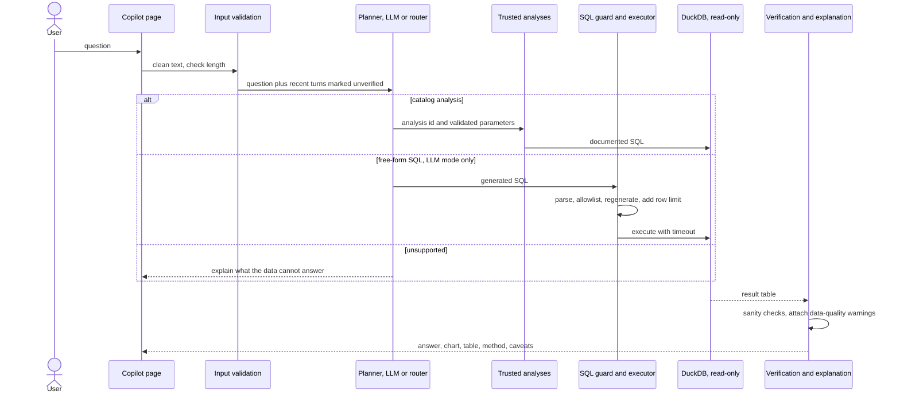

<h1 align="center">SaaS Intelligence Copilot</h1>

<p align="center">
  <b>Answers should be calculated, not invented.</b><br>
  An AI-assisted SaaS analytics and business intelligence application that turns subscription data into explainable, verifiable business insights.
</p>

<p align="center">
  <a href="https://www.python.org/"></a>
  <a href="https://streamlit.io/"></a>
  <a href="https://duckdb.org/"></a>
  <a href="https://plotly.com/python/"></a>
  <a href="https://pandas.pydata.org/"></a>
  <a href="https://github.com/tobymao/sqlglot"></a>
  
  <a href="https://docs.pytest.org/"></a>
</p>

<p align="center">
  <a href="YOUR_STREAMLIT_APP_URL"><b>Live Demo</b></a> &nbsp;·&nbsp;
  <a href="https://github.com/YOUR-USERNAME/saas-intelligence-copilot"><b>Repository</b></a> &nbsp;·&nbsp;
  <a href="#installation-and-setup"><b>Run it locally</b></a> &nbsp;·&nbsp;
  <a href="#limitations-and-known-issues"><b>Limitations</b></a>
</p>

> **Placeholders to replace before publishing.** `YOUR_STREAMLIT_APP_URL` and `YOUR-USERNAME` are placeholders. **No deployment of this application exists yet**, so there is no live demo URL. See [Live Demo](#live-demo) for the steps that produce one.

<p align="center">
  
</p>

---

## Table of Contents

1. [Visual Preview](#visual-preview)
2. [Product Overview](#product-overview)
3. [Key Features](#key-features)
4. [Live Demo](#live-demo)
5. [Architecture](#architecture)
6. [Data Workflow](#data-workflow)
7. [AI and SQL Safety Architecture](#ai-and-sql-safety-architecture)
8. [Technology Stack](#technology-stack)
9. [Project Structure](#project-structure)
10. [Installation and Setup](#installation-and-setup)
11. [Dataset Documentation](#dataset-documentation)
12. [Usage Examples](#usage-examples)
13. [Testing and Quality Assurance](#testing-and-quality-assurance)
14. [UI Design System](#ui-design-system)
15. [Deployment](#deployment)
16. [Configuration](#configuration)
17. [Limitations and Known Issues](#limitations-and-known-issues)
18. [Roadmap](#roadmap)
19. [Contributing](#contributing)
20. [License and Acknowledgements](#license-and-acknowledgements)

---

## Visual Preview

All images are real captures of the running application (headless Chromium, full dataset). Nothing here is a mock-up.

| Overview, Dark theme | AI Copilot, Dark theme |
|:--:|:--:|
|  |  |
| Executive summary, KPI cards with sparklines, tabbed analytics. | A computed answer with chart, table, method, caveats and data-quality warnings. |

| Data Quality | Methodology |
|:--:|:--:|
|  |  |
| Source status, severity counts and per-issue impact and handling. | Pipeline, metric definitions, safeguards and data dictionary. |

| Light theme | Midnight theme |
|:--:|:--:|
|  |  |

<p align="center">
  <br>
  <sub>Phone viewport (390 px): the sidebar collapses and content stacks without horizontal overflow.</sub>
</p>

---

## Product Overview

### What it does

SaaS Intelligence Copilot lets you explore SaaS subscription data (accounts, subscriptions, churn events, support tickets, feature usage) through a dashboard and through plain-English questions. Every number shown comes from either a **documented metric function** or a **validated, read-only SQL query**. Language models, when enabled, only decide *how to query*; they never supply the figures.

### The problem

Subscription data is easy to misread. In the dataset this project ships with, the same snapshot gives three defensible MRR figures depending on how subscription rows are interpreted, and two churn indicators that disagree for most accounts:

| Question (full dataset) | Definition A | Definition B | Definition C |
|---|---|---|---|
| Recorded MRR at 2024-12-31 | **$10.16M**: all open paid subscription rows | **$1.36M**: one subscription per account | **$8.09M**: definition A excluding accounts flagged churned |
| Share of accounts that churned | **22.0%** (110 of 500): `churn_flag` | **70.4%** (352 of 500): at least one churn event | n/a |

A conventional dashboard picks one definition silently. This application shows the selected definition, shows the alternatives next to it, and attaches the relevant data-quality warnings to each answer.

### What makes the architecture valuable

- **Separation of concerns.** The model plans; deterministic code calculates; a verifier checks; an explanation is accepted only if its numbers trace back to the result.
- **Defence in depth for generated SQL.** Parsed and allowlisted before execution, executed on a read-only connection with no file access, limited in rows and time ([details](#ai-and-sql-safety-architecture)).
- **Honest metrics.** A registry documents formula, date basis, grain, assumptions and limitations for 21 metrics, and marks five of them *unavailable* instead of estimating them.
- **Works offline.** Without an API key, a built-in router maps questions to the same trusted analyses.

### Who it is for

Data and analytics engineers looking for a worked example of governed natural-language analytics; SaaS founders and operators who want to see how metric definitions change conclusions; engineers and recruiters evaluating the project's design, testing and documentation.

### How it differs from a conventional dashboard

| Conventional dashboard | This project |
|---|---|
| One fixed definition per metric, often undocumented | Selected definition plus alternatives, with a status (caveated, approximate, unavailable) per metric |
| Data issues live in a separate ticket | Audit results are shown on a dedicated page and attached to the answers they could change |
| Static, pre-built charts | Free-form questions answered by trusted analyses or validated SQL, with the SQL shown |
| AI text is trusted | AI text is accepted only when every number in it is found in the computed result |
| Needs a service to run | Runs locally on DuckDB; no API key is required |

---

## Key Features

Every capability below was checked against the source code or exercised by the test suite.

### Executive overview (`views/overview.py`)

- **Executive summary** whose sentences are generated from computed values (MRR, accounts, churn, definition spread, count of high-severity data issues).
- **Five KPI cards** (MRR, ARR run-rate, active paying accounts, active paid subscriptions, account churn) built with native `st.metric` and sparklines; values are checked by tests against the backend calculation.
- **Six tabs:** Revenue, Customers, Churn & retention, Segments, Support & usage, Insights.
- **Filters:** date range, industry, country, referral source, plan.
- **Export:** a Markdown summary report from the Insights tab.

### SaaS metrics and analytics (`src/metrics/`)

| Area | What is implemented |
|---|---|
| Revenue | Recorded MRR, ARR as a 12 × MRR run-rate, new vs churned MRR, MRR by plan, industry, country and referral source |
| Subscriptions | Active paid subscriptions and paying accounts per month, new paid subscriptions, monthly subscription churn and gross MRR churn (opening-cohort definition) |
| Retention | Quarterly signup-cohort retention heatmap (event-based) |
| Segments | Account churn by industry, country, referral source, account plan and seat band, with 95% Wilson intervals and a chi-square test |
| Associations | Support response time vs churn and feature usage vs churn (quartile bands, Mann-Whitney U), reported as associations, never causes |
| Operations | Support performance by priority, most-used features |
| Diagnostics | Spike detection, a rule-based watchlist of high-MRR accounts with recent churn events, and a generated list of missing data |

### AI Copilot (`views/copilot.py`, `src/ai/`)

- **Natural-language questions** with follow-up context (the last four turns are passed to the planner, labelled *unverified*).
- **Trusted analysis routing:** a catalog of **17 analyses** with validated parameters. The planner (LLM) or the offline router picks one.
- **Validated SQL** for questions outside the catalog (LLM mode): see [safety architecture](#ai-and-sql-safety-architecture).
- **Result verification** before anything is explained.
- **Grounded explanations:** AI-written prose is rejected if it contains a number that cannot be traced to the result; the deterministic summary is shown instead.
- **Transparent output:** each answer has tabs for the data, *how it was calculated* (SQL or method), caveats, and the data-quality issues that could change it.
- **CSV export** of every result table.
- **Honest refusals:** questions about metrics the data cannot support (for example lifetime value) route to an explicit "unavailable" answer.

### Data quality monitoring (`views/data_quality.py`, `src/data/audit.py`)

- 21 audited issues on the full dataset (5 high, 9 medium, 5 low, 2 informational) and 16 integrity checks that passed.
- **Source status:** what the database was built from, plus a check that the audit describes the same input files (SHA-256 fingerprint).
- Per issue: affected records, impact on analysis and how it is handled; table profiles; join-cardinality evidence.

### Methodology transparency (`views/methodology.py`, `src/metrics/definitions.py`)

A six-step "file to answer" overview, the selected MRR definition against alternatives, the full metric registry (formula, date basis, grain, filters, assumptions, limitations, related issues), the transformations applied, the live safeguard configuration, a data dictionary and provenance.

### Design system and offline operation

Three themes (Dark, Light, Midnight) and five accent options with WCAG-tested contrast, responsive layouts and keyboard focus styles ([details](#ui-design-system)). No API key is needed for the dashboard or the offline Copilot.

---

## Live Demo

**There is no hosted demo yet.** No deployment URL exists anywhere in this repository, and none is invented here. The hero link `YOUR_STREAMLIT_APP_URL` is a placeholder.

To get a real URL, deploy to Streamlit Community Cloud (steps in [Deployment](#deployment)), then replace `YOUR_STREAMLIT_APP_URL` in the hero section and in the [Live Demo](#live-demo) section. A hosted copy would run on the bundled 60-account sample unless you supply the full dataset.

Until then, [run it locally](#installation-and-setup). A `localhost` address is not a public demo.

---

## Architecture



The same diagram, as a question-by-question sequence:



---

## Data Workflow

### Directories

| Path | Role | In Git? |
|---|---|---|
| `data/raw/` | The five original CSVs of the full dataset. **Never modified**; SHA-256 checksums are recorded at build time. | No (ignored) |
| `data/sample/` | A 60-account demo sample (about 260 KB) so the app runs after a fresh clone. Regenerate with `python scripts/make_sample.py` (needs the full dataset). | Yes |
| `data/processed/` | Generated: `saas.duckdb`, `audit.json`, `raw_manifest.json`. Only `.gitkeep` is tracked. | No (ignored) |

### Lifecycle

1. **Validate** (`src/data/schema.py`, `loader.py`): exact filenames and headers, a 50 MB per-file cap, strict type parsing. Bad values stop the build with a `SchemaError`; nothing is coerced.
2. **Audit** (`src/data/audit.py`): keys, foreign keys, dates, cross-table consistency, with severity, impact and handling per issue.
3. **Clean** (`src/data/build_db.py`): adds flags (`dq_*`) and derived columns; **no row is deleted**. Builds two marts: `account_features` (one row per account, so child tables are aggregated before joining) and `sub_enriched`.
4. **Record the source**: the database stores `data_source`, a fingerprint of the input files and a build time in a `_meta` table.
5. **Serve** read-only to the metric layer and the Copilot.

### Which database is served

`ensure_database()` in `src/analytics/db.py` decides at start-up, and the label always comes from what the database itself recorded:

- `data/raw` present: the database must have been built from exactly those files, otherwise it is rebuilt.
- Only the sample present: an existing labelled database is kept; a missing or unlabelled one is built from the sample.
- A full-data database is never silently replaced by the sample, and sample data is never labelled "full dataset".

The Pipeline command (`python -m src.data.pipeline`) is for the **full dataset only**: it fails fast with a schema error if `data/raw` is missing. A fresh clone needs no pipeline run; the app builds its own database from the sample on first start.

### Missing data, conflicts and limits

| Situation | Handling |
|---|---|
| Two fields disagree (for example `churn_flag` vs churn events: 312 of 500 accounts) | Both are kept; one is selected and documented per metric; the conflict is flagged in `account_features` and shown on the Data Quality page |
| Duplicate records (reused `usage_id`, duplicate churn events) | Flagged, kept, and excluded only where the metric definition says so |
| Fields the dataset lacks (payments, spend, user-level events) | Metrics that need them are marked **unavailable** and are never estimated |
| A metric computed from caveated data | Status `caveated` or `approximate`, with the limitation text beside the result |
| Findings from the audit | Matching issues are attached to Copilot answers by table and metric |

---

## AI and SQL Safety Architecture

Safety does not rest on the model behaving. The model can only *choose* a trusted analysis or *propose* SQL; everything it proposes passes deterministic checks, and the database enforces its own limits even if a check were bypassed.

| Layer | Mechanism | Implemented in |
|---|---|---|
| Input | Control characters removed, whitespace collapsed, empty input rejected, length capped (500 characters by default) | `src/security/input_validation.py` |
| Plan validation | Intent must be one of `analysis`, `sql`, `unsupported`, `clarify`; the analysis id must exist in the catalog; parameters must match allowed values; filters must be real values from the data | `src/ai/planner.py`, `src/analytics/catalog.py` |
| SQL parsing | Parsed into an AST with `sqlglot` (DuckDB dialect); exactly one statement; the root must be a `SELECT` or a set operation | `src/security/sql_guard.py` |
| Statement allowlist | 29 statement and node types are rejected anywhere in the tree (for example `INSERT`, `UPDATE`, `DELETE`, `CREATE`, `DROP`, `ALTER`, `COPY`, `ATTACH`, `PRAGMA`, `SET`, `INSTALL`, `INTO`, `ReadCSV`, `GenerateSeries`) | `sql_guard.py` |
| Table allowlist | Only 7 objects may be referenced (`accounts`, `subscriptions`, `churn_events`, `support_tickets`, `feature_usage`, `account_features`, `sub_enriched`); schema-qualified names, file paths and table functions are rejected; internal tables such as `_meta` are not reachable | `sql_guard.py` |
| Function allowlist | Functions that sqlglot does not model must be on a list of 94 safe names | `sql_guard.py` |
| Complexity | At most 4,000 characters, 2,500 AST nodes and 6 joins; every join needs an `ON`/`USING` that compares columns (constant conditions such as `ON 1=1` are rejected) | `sql_guard.py` |
| No parser differential | The SQL that runs is **regenerated from the validated AST** with comments removed, not the raw text | `sql_guard.py` |
| Read-only database | Connection opened `READ_ONLY` with `enable_external_access` off, a 1 GB memory limit and 2 threads | `src/analytics/db.py` |
| Row limit | The query is rewritten with `LIMIT` of 1,000 plus one row, so truncation is detected and flagged | `sql_guard.apply_row_limit`, `db.run_query` |
| Timeout | A timer interrupts the cursor after 10 seconds | `db.run_query` |
| Error hygiene | Execution errors are reduced to a short first line; API errors are translated into fixed messages | `db.py`, `src/ai/client.py` |
| Result verification | Errors for empty results, infinite values, rates outside 0-1 and negative counts; warnings for duplicated group keys, empty columns and truncation | `src/analytics/verification.py` |
| Grounded explanation | AI-written text is rejected if any number (integers 0-10 excepted) is not found in the result, facts, caveats or question, within rounding; the deterministic summary is shown instead | `src/ai/grounding.py`, `explain.py` |
| Fan-out warning | A heuristic warns when aggregating after joining tables of different granularity (a warning, not a block) | `sql_guard.py` |
| Retry | In LLM mode a rejected or failed query is regenerated **once** with the error as feedback | `src/ai/copilot.py` |
| Logging | Events record status, method, row count and timing; question text, SQL, answers and keys are not logged; key-like strings are redacted | `src/security/logging_utils.py` |
| Secrets | The API key is read from the environment only; placeholder values are ignored; `.env` is git-ignored | `src/config.py`, `.gitignore` |

**What this does not provide.** There is no authentication or rate limiting. Resistance to prompt injection in LLM mode relies on the system prompt plus the structural controls above (a model cannot run anything but one allowlisted read-only `SELECT`); it has been tested with a scripted stand-in for the model, not against a live one. See [limitations](#limitations-and-known-issues).

---

## Technology Stack

| Category | Technology | Pinned version |
|---|---|---|
| Language | Python | 3.12 (tested); see [Python version](#python-version) |
| Frontend and UI | Streamlit | 1.65.0 |
| | Plotly | 7.1.0 |
| | Custom CSS design system | `src/ui/assets/app.css` |
| Data processing | pandas | 3.0.2 |
| | NumPy | 2.4.4 |
| Database | DuckDB (embedded, read-only at run time) | 1.5.6 |
| Analytics | SciPy (chi-square, Mann-Whitney) | 1.17.1 |
| AI integration | OpenAI Python SDK (optional) | 3.26.1 |
| | python-dotenv | 1.2.2 |
| SQL validation | sqlglot | 30.21.0 |
| Testing | pytest | 9.1.1 |
| | Playwright (optional, for the browser audit script only; not in `requirements.txt`) | n/a |
| Deployment | Docker (`python:3.12-slim`) and Streamlit Community Cloud | untested, see [Deployment](#deployment) |

Versions are taken from `requirements.txt`.

---

## Project Structure

```text
saas-intelligence-copilot/
├── app.py                      # Entry point: page config, theme shell, navigation
├── views/                      # The four pages
│   ├── overview.py             #   executive dashboard
│   ├── copilot.py              #   chat with the data
│   ├── data_quality.py         #   audit results and source status
│   └── methodology.py          #   definitions, pipeline, safeguards
├── src/
│   ├── config.py               # Paths, limits, environment variables
│   ├── data/                   # schema.py, loader.py, audit.py, build_db.py, pipeline.py
│   ├── metrics/                # definitions.py (registry), calculations.py, stats.py
│   ├── analytics/              # db.py, catalog.py, insights.py, verification.py, dq_warnings.py
│   ├── ai/                     # copilot.py, planner.py, router.py, client.py, prompts.py, explain.py, grounding.py
│   ├── security/               # sql_guard.py, input_validation.py, logging_utils.py
│   └── ui/                     # theme.py, shell.py, kit.py, charts.py, components.py, assets/
├── tests/                      # 8 test files, 225 tests
├── scripts/                    # make_sample.py, gen_docs.py, gen_design_docs.py, ui_audit.py
├── docs/                       # DATASET, METRICS, DATA_QUALITY_REPORT, DESIGN_SYSTEM, DECISIONS, TEST_RESULTS, screenshots/
├── data/
│   ├── sample/                 # committed 60-account demo (5 CSVs)
│   ├── raw/                    # full dataset (you provide; git-ignored)
│   └── processed/              # generated database and audit (git-ignored)
├── .streamlit/config.toml      # Native base theme and server options
├── Dockerfile
├── pytest.ini
├── requirements.txt
└── .env.example
```

| Location | Responsibility |
|---|---|
| `src/data` | Everything between raw CSV and the analytical database; knows nothing about the UI |
| `src/metrics` | The semantic layer: one definition per metric and one function per analysis; no UI code |
| `src/analytics` | Read-only database access, the analysis catalog, insights, result verification, audit-to-answer warnings |
| `src/ai` | Question planning (LLM or offline), orchestration, grounded explanations |
| `src/security` | SQL guard, input validation, privacy-conscious logging |
| `src/ui` and `views` | Presentation only: tokens, components, charts, pages |
| `scripts` | Developer tools; `gen_docs.py` and `gen_design_docs.py` regenerate documents that tests keep in sync with the code |

---

## Installation and Setup

### Python version

Use **Python 3.12 or 3.13**. The project was developed and its suite run on 3.12. Prebuilt Windows wheels for all pinned packages exist for 3.12 to 3.14 (checked on PyPI at the time of testing). When checked, there were **no wheels for Python 3.15** for the pinned `duckdb`, `pandas`, `numpy` and `scipy`, so installation falls back to compiling from source and fails without a C++ toolchain. Use `--only-binary=:all:` to make that failure explicit instead of triggering a build.

### 1. Clone

```bash
git clone https://github.com/YOUR-USERNAME/saas-intelligence-copilot.git
cd saas-intelligence-copilot
```

### 2. Create and activate a virtual environment

**Windows (PowerShell)**

```powershell
python -m venv .venv
.\.venv\Scripts\Activate.ps1
python --version        # expect 3.12.x or 3.13.x
```

If PowerShell blocks the activation script, run `Set-ExecutionPolicy -Scope CurrentUser RemoteSigned` once and retry.

**macOS and Linux**

```bash
python3 -m venv .venv
source .venv/bin/activate
python --version        # expect 3.12.x or 3.13.x
```

### 3. Install dependencies

```bash
python -m pip install --only-binary=:all: -r requirements.txt
python -m pip check
```

### 4. Configure environment variables (optional)

No configuration is required to run the app. To enable the OpenAI planner, copy the template and add your key:

```bash
cp .env.example .env            # Windows PowerShell: Copy-Item .env.example .env
```

Never commit `.env`; it is git-ignored. See [Configuration](#configuration).

### 5. Run the application on the demo sample

```bash
python -m streamlit run app.py --server.address localhost
```

Open <http://localhost:8501>. On first start the app builds `data/processed/saas.duckdb` from the bundled sample and labels the data **Demo sample** in the interface. Streamlit listens on all network interfaces by default, so `--server.address localhost` keeps the app private to your machine; the app has no authentication.

### 6. Use the full dataset (optional)

Download the dataset (see [Dataset Documentation](#dataset-documentation)) and extract the five CSVs into `data/raw/`:

```bash
mkdir -p data/raw
unzip -j "SaaS Subscription & Churn Analytics Dataset.zip" -d data/raw
```

```powershell
Expand-Archive -LiteralPath 'SaaS Subscription & Churn Analytics Dataset.zip' -DestinationPath .\data\raw
```

Then build the database explicitly (this also writes `data/processed/audit.json` and regenerates `docs/DATA_QUALITY_REPORT.md`):

```bash
python -m src.data.pipeline
```

Expected output ends with `audit_issues: 21` and the row counts `500`, `5000`, `600`, `2000`, `25000`. Restart the app; the interface now reads **Full dataset**.

---

## Dataset Documentation

| Item | Detail |
|---|---|
| Name | RavenStack SaaS Subscription & Churn Analytics |
| Author | River @ Rivalytics |
| Source | <https://www.kaggle.com/datasets/rivalytics/saas-subscription-and-churn-analytics-dataset> |
| Format | Five CSV files, extracted flat (no sub-folder) |
| Period | 2023-01-02 to 2024-12-31 (the snapshot date is derived from the data) |
| Origin | Described as **synthetic** by its public listing; company names are placeholders. The ZIP contains no README or licence, so this is not confirmed by the files themselves |

| Table (file) | Rows (full) | Rows (sample) | Primary key | Columns |
|---|--:|--:|---|--:|
| `accounts` (`ravenstack_accounts.csv`) | 500 | 60 | `account_id` | 10 |
| `subscriptions` (`ravenstack_subscriptions.csv`) | 5,000 | 620 | `subscription_id` | 14 |
| `churn_events` (`ravenstack_churn_events.csv`) | 600 | 80 | `churn_event_id` | 9 |
| `support_tickets` (`ravenstack_support_tickets.csv`) | 2,000 | 249 | `ticket_id` | 9 |
| `feature_usage` (`ravenstack_feature_usage.csv`) | 25,000 | 3,112 | `usage_id` (not unique: 21 ids are reused) | 8 |

Relationships: `subscriptions`, `churn_events` and `support_tickets` reference `accounts.account_id`; `feature_usage` references `subscriptions.subscription_id`. There are no orphan records.

**Sample data.** `data/sample/` holds a stratified sample of 60 accounts (stratified on `churn_flag`, seed 7) with all of their child rows, produced by `scripts/make_sample.py`.

**Licensing and attribution.** The dataset's licence was not included in the file supplied and has not been confirmed by this project. Check the licence on the Kaggle page before redistributing any dataset file or sample, and credit River @ Rivalytics. The full dataset is not stored in this repository.

**Synthetic-data limitations.** Findings illustrate the method, not a real business. The data has real structural quirks (summarised on the Data Quality page and in [`docs/DATA_QUALITY_REPORT.md`](docs/DATA_QUALITY_REPORT.md)), for example:

| Issue | Finding (full dataset) |
|---|---|
| `churn_flag` vs churn events | Disagree for 312 of 500 accounts (62.4%) |
| Churned accounts still paying | All 110 churn-flagged accounts hold open paid subscriptions, worth $2,073,153 of recorded MRR |
| Concurrent subscription rows | 496 accounts (99.2%) hold more than one open paid subscription (average 7.6) |
| Usage dates | 19,432 usage rows (77.7%) fall outside their subscription window |
| No payments, spend or user-level data | Cash revenue, LTV, CAC and net revenue retention cannot be computed |

---

## Usage Examples

These questions were run through the **offline** Copilot (no API key) and route to the analysis shown.

| Question | Analysis used |
|---|---|
| What is the recorded MRR? | `current_mrr` |
| How has MRR changed month over month? | `mrr_trend` |
| Which subscription plans generate the most recorded revenue? | `revenue_breakdown` (by plan) |
| Which countries generate the most revenue? | `revenue_breakdown` (by country) |
| How does churn vary by industry? | `churn_by_segment` (industry) |
| Which acquisition channels have the highest churn? | `churn_by_segment` (referral source) |
| What are the most common recorded churn reasons? | `churn_reasons` |
| Which features are used the most? | `feature_usage_summary` |
| Is support response time associated with churn? | `support_vs_churn` |
| Which cohorts show the strongest retention? | `cohort_retention` |
| What unusual changes appear in the available data? | `unusual_changes` |
| Which high-value accounts are at risk? | `high_value_at_risk` |
| What should management do based on this data? | `business_insights` |
| What is our LTV? | `data_gaps`: explains that lifetime value is unavailable |
| What additional data would help explain churn? | `data_gaps` |

The Copilot page also offers 11 suggested questions.

**Know the offline router's limits.** It matches keywords, so phrasing matters:

- "Which features are used the most?" works; "What are the most *frequently* used features?" is **not** matched offline.
- "Which customer segments have the highest support-ticket volume?" matches `support_summary`, which reports tickets **by priority**, not by customer segment. The answer's title and headline say *by priority*.

**Free-form questions** (LLM mode, `OPENAI_API_KEY` set). A question such as *support-ticket volume by industry* needs generated SQL. The SQL it requires passes the guard and runs on the sample (for example `SELECT a.industry, COUNT(*) FROM support_tickets t JOIN accounts a USING (account_id) GROUP BY 1`), but **the LLM path has not been verified against a live model**; see [limitations](#limitations-and-known-issues).

---

## Testing and Quality Assurance

### Run the tests

```bash
python -m pytest -q -rs                     # whole suite
python -m pytest -q -m needs_credentials    # live OpenAI test (needs OPENAI_API_KEY)
python -m pip check                         # dependency consistency
```

### Latest verified results

Measured on Python 3.12.3 on Linux with the pinned dependencies.

| Scenario | Result |
|---|---|
| Full dataset in `data/raw` | **224 passed, 1 skipped** |
| Bundled demo sample only | **220 passed, 5 skipped** |

The suite has 225 tests in 8 files:

| File | Tests | Focus |
|---|--:|---|
| `tests/test_security.py` | 55 | SQL guard (40 unsafe or invalid statements rejected, 6 legitimate ones accepted), AST regeneration, fan-out warning, row limit, timeout, database file-access denial, input validation, log redaction |
| `tests/test_ui_theme.py` | 65 | WCAG contrast of every theme and accent (including tinted backgrounds), token completeness, theme and URL fallbacks, HTML escaping, regression guards |
| `tests/test_ai.py` | 36 | Planner validation, offline router, grounding, Copilot with a scripted model stand-in (retry, API failure, unsafe SQL), client error handling |
| `tests/test_metrics.py` | 21 | Metrics against hand-derived values, date and category filters, join double counting, independent pandas cross-check on the real data |
| `tests/test_ui_shell.py` | 15 | Every page in every theme, persistence across navigation and URL, invalid theme values, KPI values against the backend |
| `tests/test_data_source.py` | 13 | The database records its source; stale or mislabelled databases are rebuilt; a full-data database is never replaced by the sample |
| `tests/test_schema_and_pipeline.py` | 12 | Schema validation, duplicate and orphan detection, raw files unchanged, sample validity |
| `tests/test_app.py` | 8 | Page start-up and Copilot interaction through Streamlit's `AppTest` |

**Skipped tests, and why.** With the sample only, four skips need the full dataset (`test_real_data_independent_validation`, `test_default_date_range_excludes_no_accounts_real`, `test_real_data_reconciles`, `test_timeout_cancels_expensive_query`) and pass when it is present. One skip needs an API key (`test_real_llm_end_to_end`). With the full dataset only the API-key test is skipped.

**Pre-redesign reference.** The original code (before source tracking and the redesign) gave 131 passed, 1 skipped with the full dataset and 127 passed, 5 skipped with the sample.

### Browser and accessibility checks (automated, Chromium on Linux)

Run with `scripts/ui_audit.py` against a running app. These are scripted checks, not a manual accessibility review.

| Check | Result |
|---|---|
| WCAG AA text contrast of every visible text element, 4 pages × 3 themes | 0 below AA |
| Same check on the six Overview tabs × 3 themes | 0 below AA |
| Keyboard focus: 14 Tab presses on the Overview | 14 of 14 show a visible 2 px outline |
| Streamlit exception boxes and horizontal overflow at 1440, 768 and 390 px | none |
| Copilot in a real browser: suggestion click, typed question, unsafe input (`DROP TABLE accounts; --`) | answered or refused without error |

```bash
python -m pip install playwright && python -m playwright install chromium    # one-time, not in requirements.txt
python -m streamlit run app.py --server.port 8501 &                          # in another terminal on Windows
python scripts/ui_audit.py contrast 8501 Dark,Light,Midnight overview,copilot,dq,method
python scripts/ui_audit.py tabs 8501 Dark,Light,Midnight
python scripts/ui_audit.py focus 8501
```

**Not tested:** Edge, Firefox and Safari; screen readers; a Windows run of the final code (an earlier, pre-redesign run on Windows with Python 3.13.13 gave 127 passed, 5 skipped); the live OpenAI integration. Full details: [`docs/TEST_RESULTS.md`](docs/TEST_RESULTS.md).

---

## UI Design System

All colour, spacing and component styling flows from one token module (`src/ui/theme.py`) and one stylesheet (`src/ui/assets/app.css`); the shell (`src/ui/shell.py`) injects it once per run.

| | Dark | Light | Midnight |
|---|---|---|---|
| Page background | `#0B0D12` | `#F5F6FA` | `#060A18` |
| Card surface | `#151922` | `#FFFFFF` | `#0D1530` |
| Body text | `#E9ECF3` | `#0F172A` | `#E6ECFF` |
| Default accent | Indigo | Indigo | Teal |

**Accents:** Auto (each theme's default), Indigo, Teal, Violet and Amber, each with a lighter variant for dark themes and a darker one for Light so text stays readable.

**Behaviour**

- The selection persists across pages (session state) and across browser refreshes (the URL query string); unknown values fall back safely to Dark.
- Streamlit sets no CSS variables, so native widgets (inputs, dropdowns, calendar, tabs, chat input, expanders, alerts) are restyled through their stable `data-testid` hooks; tables use an escaped HTML component because `st.dataframe` draws on a canvas that CSS cannot theme.
- Charts are rebuilt from the active theme, so they follow theme switches.
- Responsive: the sidebar collapses on small screens, columns stack, and no page overflows horizontally at 390 px.
- Motion respects `prefers-reduced-motion`; keyboard focus uses a visible accent outline.

**Accessibility, enforced by tests.** Body text must reach 7:1 and all other text 4.5:1 on every surface, and status and accent colours must reach 4.5:1 on their own tinted backgrounds, for every theme and accent. A regression test exists because success-green once passed on plain white but failed on the tinted chip it is drawn on.

**Shared components** (`src/ui/kit.py`): page header, chips and badges, cards, executive-summary lead, callouts, stat tiles, progress bar, step flow, bullet and key-value lists, code block, empty state, and the HTML table. Every dynamic string is HTML-escaped before it is rendered. Full token tables: [`docs/DESIGN_SYSTEM.md`](docs/DESIGN_SYSTEM.md) (generated from the code by `scripts/gen_design_docs.py`).

---

## Deployment

**Nothing has been deployed.** Both options below are provided as configuration but have **not** been tested end to end.

### Streamlit Community Cloud (untested)

1. Push the repository to GitHub (see [Contributing](#contributing) for what to exclude).
2. In Streamlit Community Cloud choose **New app**, select the repository and branch, and set the main file to `app.py`.
3. In the app's advanced settings pick Python 3.12.
4. To enable the OpenAI planner, add `OPENAI_API_KEY` under **Secrets**. Do not commit it. The code reads environment variables only; whether your platform exposes a secret as an environment variable is something to confirm on first deploy.
5. Copy the generated URL into the hero link and [Live Demo](#live-demo).

A hosted copy will show the bundled **Demo sample**, because the full dataset is not in the repository. There is no authentication, so do not expose a deployment with a real API key to the public without adding access control.

### Docker (untested; the image has not been built)

```bash
docker build -t saas-intelligence-copilot .
docker run --rm -p 8501:8501 saas-intelligence-copilot
```

To use the full dataset and the OpenAI planner:

```bash
docker run --rm -p 8501:8501 \
  -v "$(pwd)/data/raw:/app/data/raw" \
  -e OPENAI_API_KEY="your-key" \
  saas-intelligence-copilot
```

The `Dockerfile` installs `requirements.txt` on `python:3.12-slim` and starts Streamlit on port 8501 bound to `0.0.0.0` inside the container.

---

## Configuration

Settings are read from environment variables (and a `.env` file if present) in `src/config.py`. `.env.example` lists the first group; the rest have working defaults.

| Variable | Default | Purpose |
|---|---|---|
| `OPENAI_API_KEY` | unset | Enables the LLM planner and explanations. Placeholder values such as `your-key-here` are treated as unset |
| `OPENAI_MODEL` | `gpt-4.1-mini` | Model name. The default is unverified against a live account |
| `SAAS_RAW_DIR` | `data/raw` | Where the full dataset CSVs are read from |
| `SAAS_DB_PATH` | `data/processed/saas.duckdb` | Location of the analytical database |
| `QUERY_TIMEOUT_SECONDS` | `10` | Wall-clock limit for any generated query |
| `QUERY_MAX_ROWS` | `1000` | Row limit for generated queries |
| `DUCKDB_MEMORY_LIMIT` | `1GB` | Memory limit of the read-only connection |
| `MAX_QUESTION_CHARS` | `500` | Maximum question length |
| `OPENAI_TIMEOUT_SECONDS` | `30` | Timeout for model calls (not listed in `.env.example`) |
| `OPENAI_MAX_RETRIES` | `2` | SDK retries for model calls (not listed in `.env.example`) |

The SQL length cap (4,000 characters) is a constant in `src/config.py`. Streamlit options live in `.streamlit/config.toml` (headless server, native Dark base theme, minimal toolbar, no usage statistics). Never place a real key in code, screenshots or documentation.

---

## Limitations and Known Issues

**Data and metrics**

- The dataset is synthetic and its fields conflict in ways documented on the Data Quality page. Conclusions are illustrations of the method.
- MRR depends on how subscription rows are read (about ten rows per account). Absolute MRR and its growth should be read with care; the application shows alternatives.
- All revenue figures are recorded subscription amounts, not cash. LTV, CAC, net revenue retention, trial conversion and cash revenue are **unavailable** because the source data lacks what they need.
- No segment shows a statistically reliable churn difference at the 5% level on the full dataset (for example industry p = 0.066); no multiple-comparison correction is applied. Churn is concentrated in the final quarter of the data, which confounds cohort comparisons.
- No predictive churn model is offered; the audited data showed no usable signal.

**AI and routing**

- **The OpenAI integration has not been verified against a live model.** It is implemented and tested with a scripted stand-in only. Prompt quality, model choice and the default model name are untested.
- The offline router is keyword-based. Some questions are not matched, and a question about support tickets by customer segment is answered *by priority* (see [Usage Examples](#usage-examples)).
- There is no authentication, rate limiting or per-user isolation.

**Verification and platform**

- No deployment exists; Docker and Streamlit Community Cloud are untested.
- Browser checks used Chromium on Linux only. No screen-reader testing was done.
- The final code has not been run on Windows by the author of this README (an earlier Windows run exists, see [Testing](#testing-and-quality-assurance)).
- Python 3.15 is unsupported with the pinned packages (no prebuilt wheels when checked).
- A console message (`Recording error: Container not found`) appears only while a screenshot is captured at phone width on the Copilot page; its source was not identified and it has no visible effect. Loading a page URL directly also logs two `404` requests to Streamlit's own health endpoints, reproduced on a minimal Streamlit navigation app, so they are not specific to this project.
- `pytest` is listed in `requirements.txt`, so it is installed with runtime dependencies.

---

## Roadmap

**Completed**

- Strict ingestion, audit and cleaning pipeline with source tracking and a self-describing database
- Metric registry and 17 trusted analyses with statistical context
- Validated, read-only SQL execution and grounded explanations
- Offline Copilot and an optional OpenAI planner (implemented; live use unverified)
- Dashboard, Copilot, Data Quality and Methodology pages
- Three themes, accent selector, WCAG-tested tokens and responsive layouts
- 225 automated tests and a scripted browser audit

**In progress**

- Nothing is tracked as in progress in this repository.

**Planned** (not implemented)

- Verify the OpenAI path against a live model and build an evaluation set for the planner
- Continuous integration to run the test suite on every push
- A first public deployment, and a build and test of the Docker image
- A payments and invoices schema, and a dated churn-status table, so cash revenue, LTV and churn timing can be measured
- Multi-browser and screen-reader testing; a Windows verification of the final code
- Authentication and rate limiting before any public deployment with an API key
- Semantic caching of repeated questions

---

## Contributing

Contributions are welcome. By contributing you agree your work may be distributed under the repository's eventual licence.

**Development setup**

```bash
git clone https://github.com/YOUR-USERNAME/saas-intelligence-copilot.git
cd saas-intelligence-copilot
python -m venv .venv && source .venv/bin/activate        # Windows: .\.venv\Scripts\Activate.ps1
python -m pip install --only-binary=:all: -r requirements.txt
python -m pytest -q -rs
```

**Workflow**

1. Fork the repository and create a branch from `main` (for example `feature/short-description`).
2. Make a focused change. Keep presentation code in `src/ui` and `views`, analytics in `src/metrics`, and never put a metric formula in a page.
3. Add or update tests with the change. Do not weaken or delete an existing assertion to make a test pass; explain any genuinely outdated test in the pull request.
4. If you change `src/metrics/definitions.py` or `src/ui/theme.py`, regenerate the documents that tests keep in sync: `python scripts/gen_docs.py` and `python scripts/gen_design_docs.py`.
5. Run `python -m pytest -q -rs` and `git diff --check`, and confirm that the SQL guard tests still pass.
6. Open a pull request describing what changed, why, how you tested it, and what you could not verify.

**Rules for every change**

- Do not commit `.env`, API keys, `data/raw`, `data/processed`, virtual environments or generated caches.
- Do not relax SQL validation, read-only access, row or time limits, or input validation to make something work.
- Report results honestly: say which checks were automated, which were manual, and which were skipped.
- Check the dataset licence before adding any data file.

---

## License and Acknowledgements

**License.** The repository does not currently contain a `LICENSE` file, so no explicit open-source licence is granted. Until one is added, default copyright applies and others may not reuse the code. Add a `LICENSE` file and update this section when you choose one.

**Dataset.** [RavenStack SaaS Subscription & Churn Analytics](https://www.kaggle.com/datasets/rivalytics/saas-subscription-and-churn-analytics-dataset) by River @ Rivalytics (Kaggle). The dataset's own licence terms apply to the data and any sample derived from it.

**Libraries.** [Streamlit](https://streamlit.io/), [DuckDB](https://duckdb.org/), [Plotly](https://plotly.com/python/), [pandas](https://pandas.pydata.org/), [NumPy](https://numpy.org/), [SciPy](https://scipy.org/), [sqlglot](https://github.com/tobymao/sqlglot), the [OpenAI Python SDK](https://github.com/openai/openai-python), [python-dotenv](https://github.com/theskumar/python-dotenv), [pytest](https://docs.pytest.org/) and [Playwright](https://playwright.dev/python/) (audit script only).

**Further reading in this repository:** [`docs/METRICS.md`](docs/METRICS.md) · [`docs/DATA_QUALITY_REPORT.md`](docs/DATA_QUALITY_REPORT.md) · [`docs/DESIGN_SYSTEM.md`](docs/DESIGN_SYSTEM.md) · [`docs/DECISIONS.md`](docs/DECISIONS.md) · [`docs/TEST_RESULTS.md`](docs/TEST_RESULTS.md) · [`docs/DATASET.md`](docs/DATASET.md)
